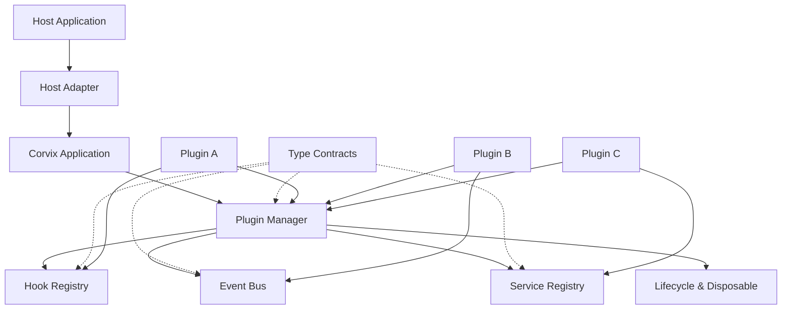

# Corvix 架构白皮书

**项目名称：** Corvix  
**发音：** /ˈkɔːrvɪks/  
**英文定位：** A Type-Safe, Hook-Driven Plugin Runtime  
**文档版本：** 0.3.0-draft  
**状态：** 架构设计阶段  
**适用语言：** TypeScript  
**核心原则：** 平台无关、类型安全、Hook 驱动、插件解耦、生命周期可管理

---

## 1. 项目概述

### 1.1 项目背景

在现代软件开发中，插件机制可以帮助应用实现能力扩展、功能隔离和模块化协作。

然而，许多插件系统在实际使用中存在以下问题：

- 插件之间的调用关系不明确，容易产生隐式依赖。
- 事件名称和数据结构缺乏编译期约束。
- 插件参与应用执行流程的方式不统一。
- 服务注册与调用缺少完整的类型推导。
- 插件生命周期和资源清理机制不完善。
- 插件系统与特定宿主环境耦合，难以复用。
- 接口发生变化后，相关插件可能无法及时发现兼容性问题。

Corvix 旨在解决这些问题，为 TypeScript 应用提供一套统一、可组合、可扩展的插件运行时。

### 1.2 项目定位

Corvix 不是单纯的事件总线、Hook 库或插件加载器，而是一套整合以下能力的运行时基础设施：

1. 插件注册、依赖解析和生命周期管理。
2. Hook 驱动的执行流程扩展。
3. 类型安全的事件发布与订阅。
4. 类型安全的服务注册与调用。
5. 统一的插件上下文与资源清理机制。
6. 宿主能力注入和运行环境适配。
7. 统一的错误处理、日志记录和运行时验证。

Corvix 的核心运行时不依赖 Electron。只要宿主环境满足所需的 JavaScript 运行能力，就可以集成 Corvix。

典型应用场景包括：

- Node.js 服务端应用。
- CLI 工具。
- Electron 主进程及其他 JavaScript 宿主。
- 自动化工具和开发者工具。
- 需要扩展机制的 TypeScript 应用。
- 可控的内部插件系统。

### 1.3 设计目标

**目标一：类型安全**

插件通过共享的类型契约获得事件参数、Hook 参数、服务接口和返回值的自动推导。

**目标二：流程可扩展**

插件能够通过 Hook 参与宿主预先定义的执行流程，而不必修改核心代码。

**目标三：插件解耦**

插件通过事件和公开服务协作，避免直接依赖其他插件的内部实现。

**目标四：生命周期可管理**

插件的注册、激活、停用和资源清理具有明确的生命周期语义。

**目标五：平台无关**

核心运行时不直接依赖浏览器 API、Electron API 或 Node.js 专有模块。

**目标六：可测试**

核心能力可以通过单元测试、类型测试和集成测试独立验证。

### 1.4 非目标

第一阶段暂不实现：

- Monorepo 和多 package 发布体系。
- UI 扩展、组件注册、路由和视图管理。
- 插件市场、在线安装和自动更新。
- 任意第三方代码的强安全沙箱。
- 跨进程透明调用 Hook。
- 分布式插件调度。
- 复杂的热更新和无状态迁移。
- 自动化的多版本插件兼容转换。

这些能力可以在后续版本中评估，不应成为首个可用版本的前置条件。

---

## 2. 核心设计原则

### 2.1 Core First

核心运行时只负责插件管理、流程扩展、通信、服务和生命周期。

操作系统能力、文件系统、网络请求、进程通信等由宿主或适配器提供。

### 2.2 Contract First

插件之间的公共交互必须具有明确的类型契约。

契约定义应先于插件实现。插件不应通过自行声明泛型、强制类型转换或使用 `any` 来绕过契约检查。

### 2.3 Explicit over Implicit

依赖关系、公开服务、插件能力和生命周期行为必须显式声明。

框架不应依赖隐式全局变量或不透明的模块加载副作用。

### 2.4 Hook、Event、Service 职责分离

三种机制解决不同的问题：

- **Hook：** 插件参与一个既定的执行流程。
- **Event：** 发布已经发生的事实，通知其他订阅者。
- **Service：** 请求其他模块提供明确的能力。

它们不能简单合并为一个通用的消息机制。

### 2.5 生命周期优先

插件注册的 Hook、事件监听、服务、定时任务及其他资源，都应有明确的所有者和释放策略。

框架必须能够在插件激活失败或停用时清理已登记的资源。

### 2.6 最小核心

第一版不引入不必要的抽象层和复杂调度机制。

只有在需求明确、接口稳定且有测试覆盖的前提下，才扩展核心能力。

---

## 3. 总体架构

### 3.1 架构分层

Corvix 采用分层架构，分为四个逻辑层。

**第一层：Core Runtime**

提供应用生命周期、插件管理、依赖解析、Hook、Event、Service 和 Disposable 等基础能力。

**第二层：Contracts**

声明宿主和插件之间的公共类型，包括事件映射、Hook 定义、服务接口及插件依赖契约。

**第三层：Host Adapter**

将宿主环境能力封装为可注入的服务，例如文件访问、日志、配置、网络和进程通信。

**第四层：Plugins**

通过统一的插件入口、上下文和契约实现独立功能。

### 3.2 逻辑架构图



图中表示逻辑关系，不代表所有模块必须运行在同一线程或进程中。第一版的核心运行时不提供跨进程透明调用。

### 3.3 依赖方向

推荐依赖方向：

- Plugin 依赖 Corvix 公共 API 和已声明的契约。
- Plugin 不应依赖其他 Plugin 的内部文件。
- Core Runtime 不依赖具体宿主。
- Host Adapter 依赖宿主 API，并向 Core Runtime 注入能力。
- Contracts 不依赖具体插件实现。

应避免出现以下依赖关系：

- 核心运行时直接调用某个业务插件。
- 插件直接访问其他插件的私有实例。
- 核心包直接导入 Electron、DOM 或 Node.js 专属模块。
- 服务注册表依赖某个具体服务实现。
- 插件之间通过隐式全局状态交换数据。

---

## 4. 核心模块设计

### 4.1 Application

Application 是 Corvix 的运行时入口。

主要职责：

- 初始化运行时。
- 管理全局契约与注册表。
- 启动插件管理器。
- 控制应用生命周期。
- 提供统一的启动和关闭入口。
- 汇总运行时错误和日志。

建议 API：

```ts
interface CorvixApplication {
  start(): Promise<void>;
  stop(): Promise<void>;
}
```

实际实现应允许传入宿主配置、契约定义和插件列表。

`start()` 和 `stop()` 应具有明确的幂等语义。启动失败时，框架需要执行回滚并报告原始错误及清理错误。

### 4.2 Plugin Manager

Plugin Manager 管理插件的注册和生命周期。

核心职责：

- 注册插件定义。
- 验证插件元数据。
- 检查依赖关系。
- 解析启动顺序。
- 创建 PluginContext。
- 执行插件激活。
- 管理插件停用和资源清理。
- 隔离插件生命周期错误。

建议生命周期：

`discovered → registered → resolving → activating → active → deactivating → inactive`

失败状态为 `failed`。

其中，`discovered` 可由宿主负责，也可以由可选的发现适配器提供；核心运行时至少应支持显式注册插件。

### 4.3 Hook Registry

Hook Registry 是 Corvix 的核心流程扩展引擎。

插件可以注册 Hook Handler，参与宿主定义的执行流程。

主要职责：

- 注册 Hook。
- 根据 Hook 定义验证调用形式。
- 管理 Handler 优先级和顺序约束。
- 执行同步或异步 Handler。
- 处理 Waterfall、Bail 等执行语义。
- 隔离 Handler 错误。
- 随插件生命周期清理 Hook 注册。

Hook 的注册名和参数结构应来自公共契约，而不是由插件任意创建后再通过类型断言使用。

### 4.4 Event Bus

Event Bus 提供类型安全的发布与订阅机制。

主要职责：

- 管理事件监听器。
- 根据事件名推导 Payload 类型。
- 提供监听器注销机制。
- 定义事件派发顺序。
- 处理监听器异常。
- 在插件停用时移除其监听器。

事件应表达已经发生的事实，例如：

- `file:opened`
- `file:saved`
- `workspace:changed`
- `plugin:activated`

对于需要改变结果或参与执行流程的操作，应优先使用 Hook 或 Service，而不是滥用 Event。

### 4.5 Service Registry

Service Registry 用于注册和获取公开服务。

主要职责：

- 管理服务名称和对应接口。
- 检查重复注册。
- 检查服务所有者。
- 管理服务依赖。
- 在服务不可用时提供明确错误。
- 随插件生命周期撤销服务。

服务调用方应通过契约自动推导方法参数和返回值。

服务注册和获取不应依赖开发者在每次调用时手写泛型参数。

### 4.6 Disposable

Disposable 提供统一的资源生命周期管理。

建议抽象：

```ts
interface Disposable {
  dispose(): void | Promise<void>;
}
```

DisposableCollection 应支持：

- 注册清理回调。
- 注册其他 Disposable。
- 一次性清理全部资源。
- 防止重复清理。
- 收集清理错误。
- 在插件激活失败时执行回滚。

清理过程应尽可能释放全部资源，而不是因为第一个清理回调失败就停止。

对于异步资源，框架应统一使用可等待的清理流程。

---

## 5. 插件定义与生命周期

### 5.1 插件接口

建议将插件的元数据和实现分开。

```ts
interface PluginDefinition {
  manifest: PluginManifest;
  setup(context: PluginContext): void | Promise<void>;
}
```

`PluginManifest` 描述插件的身份、版本、依赖和能力声明。

```ts
interface PluginManifest {
  id: string;
  version: string;
  apiVersion: string;
  dependencies?: Record<string, string>;
  optionalDependencies?: Record<string, string>;
  capabilities?: string[];
}
```

实际实现可根据类型约束进一步细化版本格式、依赖范围及能力标识。

### 5.2 激活过程

建议采用以下流程：

1. 验证插件 ID 和元数据。
2. 验证插件 API 版本。
3. 检查依赖是否存在。
4. 解析依赖关系及启动顺序。
5. 创建插件专属的 PluginContext。
6. 开始记录该插件创建的资源。
7. 执行插件 `setup()`。
8. 在成功后将插件标记为 `active`。

如果 `setup()` 失败，应清理该插件已经注册的资源，并将插件标记为 `failed`。

### 5.3 停用过程

停用时应：

1. 阻止新的、由该插件发起的受控操作。
2. 根据依赖关系确定停用顺序。
3. 执行插件定义的停用逻辑（如果提供）。
4. 清理 Hook、Event、Service 等注册。
5. 释放其他资源。
6. 更新插件状态。

停用顺序通常应与激活顺序相反，以降低依赖失效风险。

第一版不要求支持任意插件的无缝热卸载，但必须确保正常关闭和激活失败后的资源清理可预测。

---

## 6. PluginContext 设计

### 6.1 设计目标

PluginContext 是插件访问 Corvix 能力的统一入口。

它应当：

- 屏蔽内部注册表实现。
- 提供严格类型推导。
- 限制插件只能访问明确开放的 API。
- 管理插件所拥有的资源。
- 避免插件直接修改核心运行时状态。

建议包含：

```ts
interface PluginContext<
  TEvents,
  THooks,
  TServices
> {
  hooks: HookAPI<THooks>;
  events: EventAPI<TEvents>;
  services: ServiceAPI<TServices>;
  logger: Logger;
  disposables: DisposableCollection;
}
```

这里的 `TEvents`、`THooks` 和 `TServices` 代表宿主定义的公共契约类型。

以上是架构示意。正式实现应确保每个 API 的泛型参数与对应的契约映射正确关联，并限制不合法的名称和参数组合。

### 6.2 插件上下文隔离

每个插件应获得独立的上下文视图。

上下文内部可以引用同一套注册表，但插件的资源必须归属于其自身。

例如，Plugin A 注册的事件监听器不能因为 Plugin B 停用而被错误移除。

同样，Plugin A 不能随意清理 Plugin B 注册的服务。

需要注意：这种隔离属于运行时的所有权管理，并不等于对恶意代码提供安全沙箱。

---

## 7. Hook 系统设计

### 7.1 Hook 类型

Corvix 第一版建议支持以下执行语义。

| 类型 | 执行方式 | 典型用途 |
|---|---|---|
| Sync | 同步顺序执行 | 同步扩展点 |
| AsyncSeries | 异步串行执行 | 初始化和有序处理 |
| AsyncParallel | 异步并行执行 | 相互独立的处理任务 |
| Waterfall | 逐个传递并转换结果 | 参数和结果加工 |
| Bail | 遇到约定的终止结果时停止 | 决策、拦截和短路 |

这些类型应有明确的输入、输出、错误和终止语义。

### 7.2 Hook 定义

建议在宿主契约中显式声明 Hook：

```ts
interface AppHooks {
  "workspace:beforeOpen": {
    args: {
      workspaceId: string;
    };
    result: {
      allowed: boolean;
    };
  };

  "workspace:transformConfig": {
    args: {
      config: WorkspaceConfig;
    };
    result: WorkspaceConfig;
  };
}
```

这段代码展示的是概念结构。正式 API 需要为不同 Hook 模式定义更精确的参数和返回值规则。

### 7.3 Handler 顺序

第一版建议提供：

- `priority`：数值优先级。
- 稳定的同优先级注册顺序。
- 可选的 `before` 和 `after` 约束。
- 明确的循环依赖检测。

只有在确有需要时才引入复杂排序规则。

若 `before`、`after` 形成循环，应在启动或注册阶段报告清晰错误，而不是在运行时产生不确定的执行顺序。

### 7.4 错误语义

Hook 错误策略必须按执行模式定义。

- 同步 Hook：Handler 抛出异常时按既定错误策略处理。
- 异步串行 Hook：失败后默认停止后续执行。
- 异步并行 Hook：应明确失败聚合、等待其他任务及取消策略。
- Waterfall Hook：应明确中间结果类型和失败行为。
- Bail Hook：应区分合法的短路结果和真正的异常。

不应使用一个模糊的 `any` 返回值来统一所有 Hook 模式。

---

## 8. 类型安全的事件系统

### 8.1 事件契约

事件名称应通过映射类型集中声明。

```ts
interface AppEvents {
  "file:opened": {
    filePath: string;
  };

  "file:saved": {
    filePath: string;
    contentHash: string;
  };

  "workspace:changed": {
    workspaceId: string;
  };
}
```

### 8.2 API 设计要求

目标使用方式：

```ts
ctx.events.on("file:saved", payload => {
  payload.filePath;
  payload.contentHash;
});

ctx.events.emit("file:saved", {
  filePath: "/project/readme.md",
  contentHash: "abc123",
});
```

TypeScript 应自动推导：

- 合法事件名称。
- 对应事件的 Payload 类型。
- 必填和可选字段。
- 发布事件时的参数要求。

以下调用应在编译阶段报错：

```ts
// @ts-expect-error 未声明的事件
ctx.events.emit("file:deleted", {});

// @ts-expect-error 缺少 contentHash
ctx.events.emit("file:saved", {
  filePath: "/project/readme.md",
});
```

### 8.3 运行时约束

TypeScript 类型只在编译期提供约束，不能验证运行时传入的任意数据。

对于来自网络、IPC、配置文件或其他不可信来源的数据，应使用运行时 Schema 验证，例如 Zod。

事件总线还应明确：

- 监听器是否按注册顺序执行。
- 同步异常如何处理。
- 异步监听器是否受支持。
- 是否允许重复注册。
- 监听器清理是否幂等。

第一版建议优先提供可预测的同步事件分发。若需要异步事件，应提供独立且语义明确的 API，而不是隐式混合同步和异步行为。

---

## 9. 类型安全的服务系统

### 9.1 服务契约

服务映射集中声明：

```ts
interface FileService {
  readText(path: string): Promise<string>;

  writeText(
    path: string,
    content: string
  ): Promise<void>;
}

interface AIService {
  complete(prompt: string): Promise<string>;
}

interface AppServices {
  file: FileService;
  ai: AIService;
}
```

### 9.2 使用方式

```ts
const fileService = ctx.services.get("file");

const content = await fileService.readText(
  "/project/readme.md"
);
```

框架应自动推导：

- `"file"` 对应 `FileService`。
- `readText()` 的参数为 `string`。
- 返回值为 `Promise<string>`。
- `writeText()` 的参数和返回值与接口一致。

未知服务名称和不符合接口的调用应在编译期报错。

### 9.3 服务注册

服务提供者应通过受控接口注册服务。

```ts
services.register("file", fileServiceImplementation);
```

正式实现需要让注册参数与 `AppServices["file"]` 关联，防止注册了错误的实现。

### 9.4 服务依赖与生命周期

服务注册表必须明确服务的所有者和可用状态。

第一版建议采用以下规则：

- 同名服务默认禁止重复注册。
- 服务注册由插件管理器或受控的注册 API 执行。
- 插件停用时，撤销该插件拥有的服务注册。
- 调用不存在或已撤销的服务时，返回明确错误。
- 插件依赖其他插件的服务时，应在激活前检查依赖是否满足。

第一版不需要实现完整的依赖注入容器。服务注册和获取足以满足核心需求。

---

## 10. 插件间协作模型

### 10.1 三种协作方式

**流程参与：Hook**

例如，插件在工作区打开前检查权限，或者在配置保存前转换数据。

**事实通知：Event**

例如，工作区打开成功后广播 `workspace:opened`，其他插件可以监听并执行自己的任务。

**能力调用：Service**

例如，一个插件调用文件服务读取内容，而不需要知道文件服务由哪个插件实现。

### 10.2 推荐协作流程

以工作区打开为例：

1. 宿主调用工作区服务或应用命令。
2. 宿主触发 `workspace:beforeOpen` Hook。
3. 各插件按既定顺序参与校验。
4. 宿主执行实际打开操作。
5. 成功后发布 `workspace:opened` 事件。
6. 其他插件收到事件后更新自己的状态。

这样可以把可拦截的流程、已发生的事实和能力调用分开，减少隐式耦合。

---

## 11. 平台无关与宿主适配

### 11.1 核心层约束

Core Runtime 不应直接依赖：

- Electron API。
- DOM 和浏览器窗口对象。
- Node.js 专有模块。
- 特定操作系统 API。
- 特定云平台服务。

核心模块应使用标准 TypeScript 类型，并将平台能力作为接口注入。

### 11.2 宿主能力接口

例如：

```ts
interface Logger {
  debug(message: string, context?: unknown): void;
  info(message: string, context?: unknown): void;
  warn(message: string, context?: unknown): void;
  error(message: string, context?: unknown): void;
}

interface HostCapabilities {
  logger: Logger;
}
```

未来可通过宿主适配器提供更多能力：

- 文件访问。
- 配置存储。
- 网络请求。
- 定时任务。
- 子进程或 Worker 管理。
- IPC 通信。
- 权限检查。

这些接口不必全部进入核心包。只有真正跨宿主通用的抽象，才应进入 Core Runtime。

### 11.3 跨进程能力

Corvix 核心不假定插件之间能够跨线程或跨进程直接共享对象。

如需跨进程协作，应由宿主适配器定义传输协议，并明确：

- 序列化规则。
- Schema 验证。
- 权限边界。
- 超时和取消。
- 错误传播。
- 服务可用性。

跨进程服务代理可以在后续版本中实现，但不应与第一版的本地服务注册表混为一谈。

---

## 12. 错误处理与安全设计

### 12.1 错误分类

建议统一定义以下错误类别：

- `PluginRegistrationError`
- `PluginDependencyError`
- `PluginActivationError`
- `PluginDeactivationError`
- `HookExecutionError`
- `EventDispatchError`
- `ServiceNotFoundError`
- `DuplicateRegistrationError`
- `ContractValidationError`

错误应携带足够的上下文，例如插件 ID、Hook 名称、事件名或服务名。

### 12.2 错误隔离

插件异常不应导致整个运行时无条件崩溃。

但也不能一律吞掉错误。

应根据执行语义决定：

- 当前操作是否终止。
- 后续 Handler 是否继续执行。
- 是否回滚当前插件激活。
- 是否将插件标记为失败。
- 是否允许宿主继续运行。

### 12.3 资源清理

激活失败时，应清理该插件已经注册的 Hook、事件监听器和服务。

清理过程自身也可能失败，因此框架应保留原始激活错误，并同时记录清理错误。

### 12.4 类型安全不等于安全沙箱

TypeScript 类型检查不能防止恶意代码访问文件系统、读取环境变量或修改共享状态。

如果未来支持外部第三方插件，应另行设计真正的隔离机制，包括进程隔离、权限控制、通信协议和资源限制。

第一版应以可信的内部插件为主要使用场景。

---

## 13. 技术选型

| 领域 | 建议方案 | 原因 |
|---|---|---|
| 开发语言 | TypeScript | 统一的契约和静态类型检查 |
| 模块系统 | ESM | 采用现代 JavaScript 模块体系 |
| 包管理器 | pnpm | 依赖管理高效，不代表采用 Monorepo |
| 类型检查 | TypeScript Compiler | 验证契约和 API 推导 |
| 运行时验证 | Zod | 验证外部数据与边界输入 |
| 单元测试 | Vitest | 测试 Hook、Event、Service 和生命周期 |
| 集成测试 | Vitest | 验证多个插件的协作行为 |
| 端到端测试 | 按需引入 Playwright | 仅在存在实际宿主 UI 测试需求时使用 |
| Hook 实现 | 评估轻量库或自研 | 以所需执行语义和类型推导为评估依据 |

技术选型应优先保证 API 的稳定性和语义清晰度，而不是为了减少少量代码而引入过重的依赖。

---

## 14. 项目目录结构

第一版采用单项目结构，不使用 Monorepo。

```text
corvix/
├── src/
│   ├── application/
│   │   ├── application.ts
│   │   └── lifecycle.ts
│   ├── plugin/
│   │   ├── plugin.ts
│   │   ├── plugin-manager.ts
│   │   ├── plugin-context.ts
│   │   ├── plugin-manifest.ts
│   │   └── dependency-resolver.ts
│   ├── hooks/
│   │   ├── hook-registry.ts
│   │   ├── hook-types.ts
│   │   └── hook-errors.ts
│   ├── events/
│   │   ├── event-bus.ts
│   │   └── event-types.ts
│   ├── services/
│   │   ├── service-registry.ts
│   │   └── service-types.ts
│   ├── lifecycle/
│   │   └── disposable.ts
│   ├── contracts/
│   │   ├── app-events.ts
│   │   ├── app-hooks.ts
│   │   ├── app-services.ts
│   │   └── app-commands.ts
│   ├── logging/
│   │   └── logger.ts
│   └── index.ts
├── tests/
│   ├── hooks/
│   ├── events/
│   ├── services/
│   ├── plugin/
│   ├── lifecycle/
│   └── types/
├── examples/
│   └── basic-plugins/
├── package.json
├── tsconfig.json
└── README.md
```

其中 `contracts/` 是应用使用的契约定义示例。正式设计应允许宿主定义自己的契约，而不是把所有业务事件和服务固定在 Corvix 核心中。

目录名称可以随着实现调整，但不应改变模块之间的依赖边界。

---

## 15. TypeScript 严格模式

建议启用以下编译选项：

```json
{
  "compilerOptions": {
    "strict": true,
    "noImplicitAny": true,
    "strictNullChecks": true,
    "noUncheckedIndexedAccess": true,
    "exactOptionalPropertyTypes": true,
    "noEmit": true
  }
}
```

构建输出应由实际使用的构建工具负责，因此 `noEmit` 是否启用，需要根据最终构建方案确定。

### 15.1 类型测试

类型测试应作为核心测试的一部分。

除了验证正常调用，还必须验证非法调用无法通过编译：

- 未声明的事件名。
- 错误的事件 Payload。
- 未声明的 Hook 名称。
- 错误的 Hook 参数。
- 未声明的服务名称。
- 不符合服务接口的实现。
- 错误的服务方法参数。
- 不兼容的返回值。

可以使用 `@ts-expect-error` 编写负向类型测试，确保非法调用仍然被编译器拒绝。

### 15.2 契约变更

同一项目中的插件共享契约类型，因此修改契约后，可以通过完整类型检查发现受影响的调用。

但类型系统不能自动保证所有运行时兼容性。

当插件被独立发布、运行时加载或通过远程协议通信时，还需要版本兼容策略、运行时 Schema 和集成测试。

---

## 16. 测试策略

### 16.1 Hook 测试

- 每种 Hook 模式的执行顺序。
- 同优先级 Handler 的稳定顺序。
- `before`、`after` 约束。
- Waterfall 结果传递。
- Bail 的短路行为。
- 同步和异步异常处理。
- 插件停用后的 Hook 清理。

### 16.2 Event 测试

- 事件发布与订阅。
- Payload 类型约束。
- 监听器注销。
- 重复注册处理。
- 监听器异常隔离。
- 异步监听器语义（若支持）。

### 16.3 Service 测试

- 正确的服务注册与获取。
- 重复注册处理。
- 未注册服务的错误。
- 插件停用后的服务撤销。
- 依赖服务不可用时的行为。
- 服务实现的编译期接口检查。

### 16.4 插件生命周期测试

- 正常激活和停用。
- 依赖顺序。
- 缺失依赖。
- 依赖循环。
- 激活失败回滚。
- 重复启动和停止。
- Disposable 幂等清理。
- 多个清理任务中出现错误时的处理。

### 16.5 验收原则

不能只依赖代码覆盖率。

每个核心模块都必须同时具备行为测试和类型测试。对于生命周期、错误回滚和资源清理等关键逻辑，还应增加集成测试。

---

## 17. 分阶段实施计划

### Phase 1：核心运行时

实现：

- Application。
- Plugin 定义和注册。
- PluginContext。
- Plugin Manager 的基础生命周期。
- Disposable。

验收标准：能够注册插件、激活插件、停止插件，并确保资源正确清理。

### Phase 2：类型安全通信

实现：

- Hook Registry。
- Event Bus。
- Service Registry。
- 统一契约映射。
- 类型测试。

验收标准：插件在不手写调用泛型、不使用 `any` 绕过检查的情况下，能够获得正确的参数和返回值推导。

### Phase 3：依赖和错误处理

实现：

- 插件依赖解析。
- 启动顺序。
- 循环依赖检测。
- 激活失败回滚。
- 统一错误类型。
- 日志接口。

验收标准：依赖缺失、依赖循环和激活失败都有明确的错误及可预测的清理行为。

### Phase 4：宿主适配

实现：

- 宿主能力注入。
- 运行时配置。
- 必要的外部输入 Schema 验证。
- 一个最小宿主示例。

验收标准：核心运行时不直接依赖特定宿主 API，且可以在目标 JavaScript 环境中运行。

### Phase 5：稳定化

实现：

- 完整的行为测试。
- 类型回归测试。
- API 文档。
- 最小示例。
- 版本与兼容性约定。

验收标准：核心 API 稳定，关键生命周期行为有测试覆盖，示例可以独立运行。

---

## 18. 第一版验收标准

Corvix 的第一个可用版本至少应满足以下条件：

- 可以注册并管理多个插件。
- 可以声明和解析插件依赖。
- 可以定义并执行不同模式的 Hook。
- 可以发布和订阅类型安全的事件。
- 可以注册并调用类型安全的服务。
- 每个插件拥有独立的 PluginContext。
- 插件资源可以统一清理。
- 激活失败可以触发资源回滚。
- 错误具有明确的类型和上下文。
- 核心运行时不依赖 Electron 或 UI 框架。
- 编译器可以发现事件、Hook 和 Service 契约中的常见错误。
- 核心模块具有行为测试、类型测试和集成测试。

不要求第一版实现插件市场、任意代码沙箱、跨进程透明调用或复杂热更新。

---

## 19. 风险与待决策事项

### 19.1 Hook API 的类型复杂度

不同 Hook 模式具有不同的参数、返回值和错误语义。

如果试图通过一个高度泛化的接口覆盖所有模式，可能导致类型难以理解或推导失效。

应优先保证常见场景的类型体验，再逐步增加高级能力。

### 19.2 插件依赖与服务依赖

插件依赖关系和服务调用关系不是同一个概念。

依赖声明用于控制激活顺序和可用性；服务调用用于运行时能力访问。二者应保持独立，但可以建立明确的关联规则。

### 19.3 动态插件加载

静态 TypeScript 契约无法自动保证动态加载的 JavaScript 插件符合接口。

如果未来支持动态安装或外部插件，需要补充运行时验证、版本约束和权限策略。

### 19.4 并行 Hook 的取消与错误聚合

并行执行需要明确失败后是否等待其他任务、是否取消剩余任务，以及如何返回多个错误。

第一版可以采用简单、可预测的默认策略，避免过早实现复杂的取消体系。

### 19.5 命名与公开 API

项目品牌已确定为 Corvix，但正式发布前仍需单独评估包名、仓库名和商标可用性。

API 命名应保持统一，不应为了品牌名称而引入难以理解的术语。

---

## 20. 总结

Corvix 的核心价值不在于单独提供 Hook、Event 或 Service，而在于将这些机制整合成一套有明确边界、类型安全、生命周期可管理的通用插件运行时。

其核心设计可以概括为：

- **Hooks** 负责扩展执行流程。
- **Events** 负责发布事实和通知订阅者。
- **Services** 负责提供可调用的能力。
- **Plugin Manager** 负责插件生命周期与依赖关系。
- **Disposable** 负责资源所有权和清理。
- **Contracts** 负责连接编译期类型系统与插件公共接口。
- **Host Adapters** 负责隔离平台差异。

第一版应坚持轻量核心、明确契约和严格测试，优先证明插件生命周期、Hook 执行语义及端到端类型推导可以可靠协同。

在这些基础能力稳定之后，再考虑跨进程扩展、动态插件加载、沙箱和更复杂的生态能力。

**Corvix 的长期目标，是为 TypeScript 应用提供一套可组合、可验证、与宿主平台解耦的插件运行时基础设施。**
